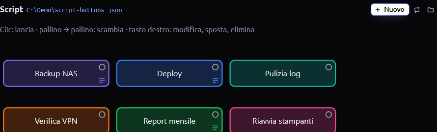
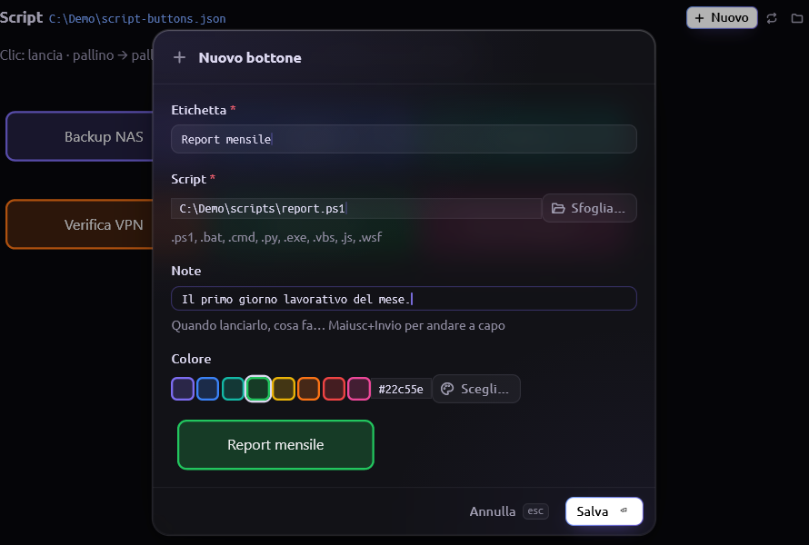
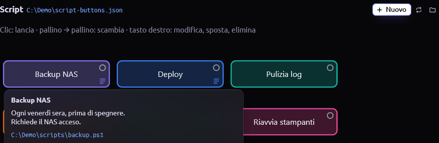
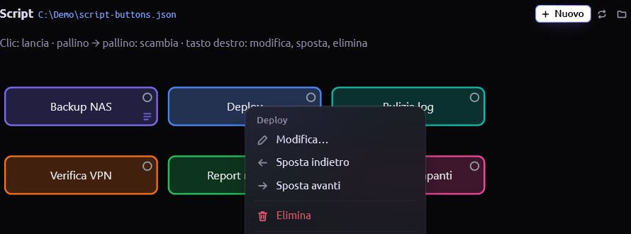
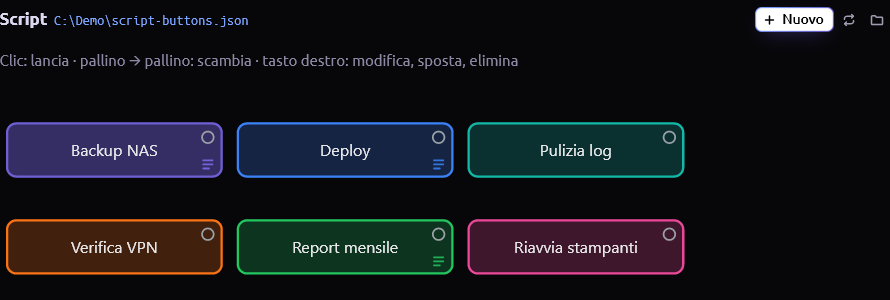
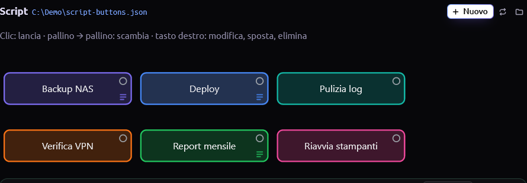
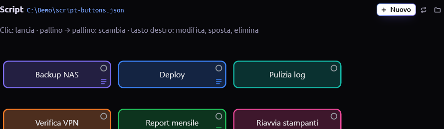

# Script Buttons

Plugin per [Tern](https://docs.stencil.so/tern/) su Windows: un blocco con bottoni colorati,
ognuno collegato a uno script locale. Un clic lancia lo script, e l'output compare
nel blocco sotto i bottoni, con l'esito alla fine. Se lo script chiede qualcosa,
rispondi da un campo di input.



## Funzioni

- **Bottoni colorati**: etichetta, script e colore hex a scelta (sfondo
  trasparente, bordo pieno). Ci sono 8 colori pronti, oppure il selettore colori
  di Windows.
- **Note**: un testo libero per bottone, per esempio quando va lanciato lo
  script. Si vede passando sopra il bottone; i bottoni con una nota hanno una
  piccola icona ≡ in basso a destra.
- **Riordino con la freccia**: clic sul pallino di un bottone, poi sul pallino di
  un altro; compare una freccia e i due bottoni si scambiano di posto.
- **Output nel blocco**: mentre lo script gira vedi lo spinner, il tempo
  trascorso e l'output riga per riga. Alla fine compare l'esito (Completato,
  Errore con il codice di uscita, Fermato) con la durata.
- **Input**: un campo sotto l'output manda una riga allo script a ogni Invio,
  per `Read-Host`, `input()` e `set /p`.
- **Selettori di Windows** per scegliere lo script, il colore e la cartella della
  configurazione.

## Requisiti

- Windows 10/11 con Windows PowerShell 5.1 (già presente in Windows).
- Tern con i plugin attivi. Testato con Tern 0.9.18.
- `git` nel `PATH`, per installare da GitHub.
- Python nel `PATH`, solo per lanciare script `.py`.

## Installazione

In un pane di Tern:

```powershell
tern plugin install github.com/MrsKugla/custom-script-buttons
```

Tern copia il
plugin nella sua cartella dei plugin (`tern plugin dir` la mostra) e lo carica
subito. Per controllare che sia stato caricato:

```powershell
tern plugin list
```

Nell'elenco deve comparire `custom-script-buttons … ready`.

Per installare da una cartella locale, per esempio un clone del repository:

```powershell
tern plugin install C:\percorso\custom-script-buttons
```

## Aggiornamento

Tern non ha un comando di aggiornamento: per aggiornare si reinstalla con
`--force`, che sostituisce la copia installata:

```powershell
tern plugin install github.com/MrsKugla/custom-script-buttons --force
```

Il plugin si ricarica da solo. Restano invariati i bottoni (stanno nei file
`script-buttons.json` delle tue cartelle) e la cartella di ogni blocco aperto.
Uno script in esecuzione durante l'aggiornamento continua a girare, ma il blocco
ne perde l'esito e mostra "Interrotto (plugin ricaricato)".

`tern plugin list` mostra la versione installata.

## Disinstallazione

```powershell
tern plugin remove custom-script-buttons
```

Le configurazioni `script-buttons.json` nelle tue cartelle restano dove sono.

## Uso

### Aprire il blocco

Dalla palette dei comandi (Ctrl+Shift+P) scegli **New Script Buttons block**. Il
blocco usa la cartella del pane da cui lo apri e ci crea `script-buttons.json`.
Se quella cartella non si trova, il blocco chiede per prima cosa dove salvare la
configurazione. Il pulsante 📁 in alto cambia cartella.

Più blocchi aperti sulla stessa cartella condividono gli stessi bottoni.

### Aggiungere e modificare un bottone

**+ Nuovo** apre il form. Per modificare un bottone usa il tasto destro →
**Modifica…**.



| Campo | Note |
| --- | --- |
| Etichetta | Il testo sul bottone |
| Script | Percorso del file; **Sfoglia…** apre il selettore file di Windows |
| Note | Facoltative; Maiusc+Invio per andare a capo |
| Colore | Uno degli 8 colori pronti, un hex (`#22c55e`) o **Scegli…** per il selettore colori |

Tab passa da un campo all'altro, Invio salva, Esc annulla.

Le note si vedono passando sopra il bottone:



### Riordinare, spostare, eliminare

Clic sul pallino in alto a destra di un bottone (diventa rosso), poi sul pallino
del bottone con cui scambiarlo. Esc annulla.


Il tasto destro su un bottone offre anche **Sposta indietro**, **Sposta avanti** ed
**Elimina** (con conferma; lo script resta sul disco).



### Lanciare uno script

Un clic sul bottone lancia lo script nella sua cartella. Si lancia uno script
alla volta per blocco; **Ferma** termina lo script e i processi che ha avviato.



Se lo script chiede un input, scrivi la risposta nel campo `›` e premi Invio. La
riga inviata compare nell'output in azzurro:



Alla fine compaiono l'esito e la durata; l'output degli errori (stderr) è in
rosso. **Rilancia** ripete lo script, **Pulisci** chiude il riquadro.



## Tipi di script

| Estensione | Lanciato con |
| --- | --- |
| `.ps1` | `powershell.exe -NoProfile -ExecutionPolicy Bypass -File` |
| `.bat`, `.cmd` | `cmd.exe /d /c` |
| `.py`, `.pyw` | `python -u` (UTF-8) |
| `.exe`, `.com` | direttamente |
| `.vbs`, `.vbe`, `.js`, `.jse`, `.wsf` | `cscript.exe //nologo` |
| altre | `cmd.exe /d /c` (associazione del file) |

## Limiti

- L'input è una riga alla volta, inviata con Invio. I programmi che leggono un
  tasto singolo (`pause`, `choice`) non ricevono niente.
- Quello che scrivi nel campo di input è visibile in chiaro, password comprese.
- Gli script girano senza finestra: programmi con interfaccia grafica possono
  aprire comunque le loro finestre, ma l'output in console non arriva.
- L'output mostrato è limitato agli ultimi 256 KB; dopo un riavvio di Tern il
  blocco ne conserva gli ultimi 16 KB.

## Dove sono i dati

| Cosa | Dove |
| --- | --- |
| Bottoni (etichetta, percorso, colore, note) | `script-buttons.json` nella cartella scelta per il blocco |
| Output e input dell'ultimo lancio | `%LOCALAPPDATA%\Tern\plugin-data\custom-script-buttons\` (sostituiti al lancio successivo dallo stesso blocco) |

Formato di `script-buttons.json`:

```json
{
  "version": 1,
  "buttons": [
    {
      "id": "b1",
      "label": "Backup NAS",
      "path": "C:\\scripts\\backup.ps1",
      "color": "#7c6cf0",
      "note": "Ogni venerdì sera."
    }
  ]
}
```

## Sviluppo

Per lavorare sul plugin, collega la cartella invece di installarla: Tern la
ricarica a ogni salvataggio.

```powershell
tern plugin link C:\percorso\custom-script-buttons
tern plugin types C:\percorso\custom-script-buttons   # tern.d.luau per luau-lsp
```

`tern plugin unlink custom-script-buttons` scollega la cartella. Una copia
installata e una collegata con lo stesso id non possono convivere: prima di
installare, scollega.

| File | Contenuto |
| --- | --- |
| `plugin.toml` | Manifest |
| `host.luau` | Il blocco: vista, eventi, configurazione |
| `styles.css` | Stili del blocco |
| `run.ps1` | Avvia lo script, raccoglie l'output e inoltra l'input |
| `pick.ps1` | Selettori di Windows (file, cartella, colore) |

## Licenza

MIT, vedi [LICENSE](LICENSE).
